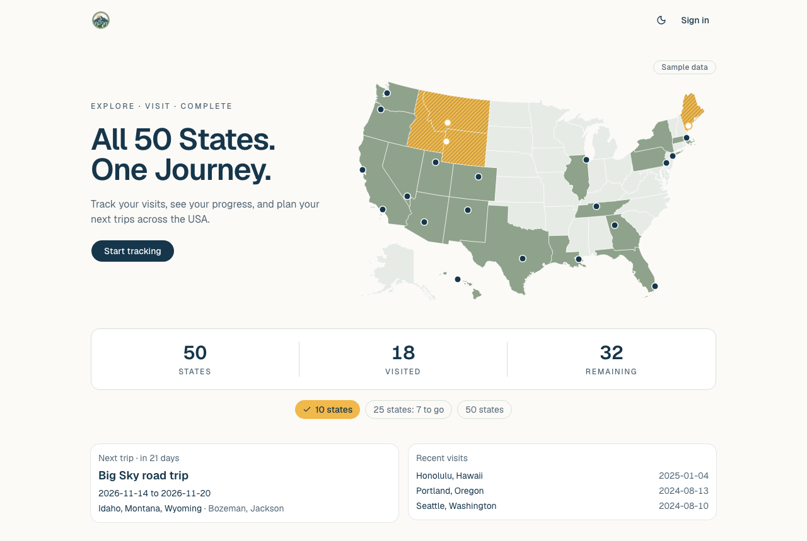
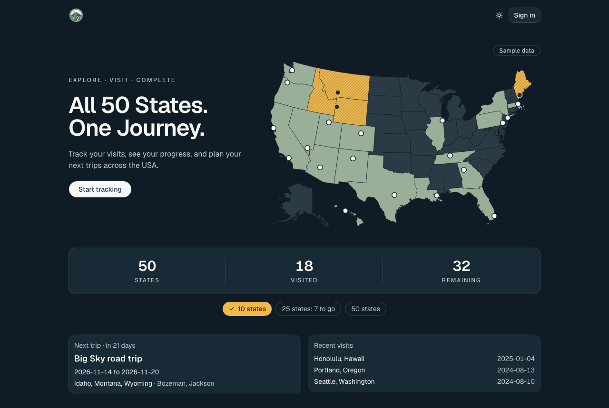
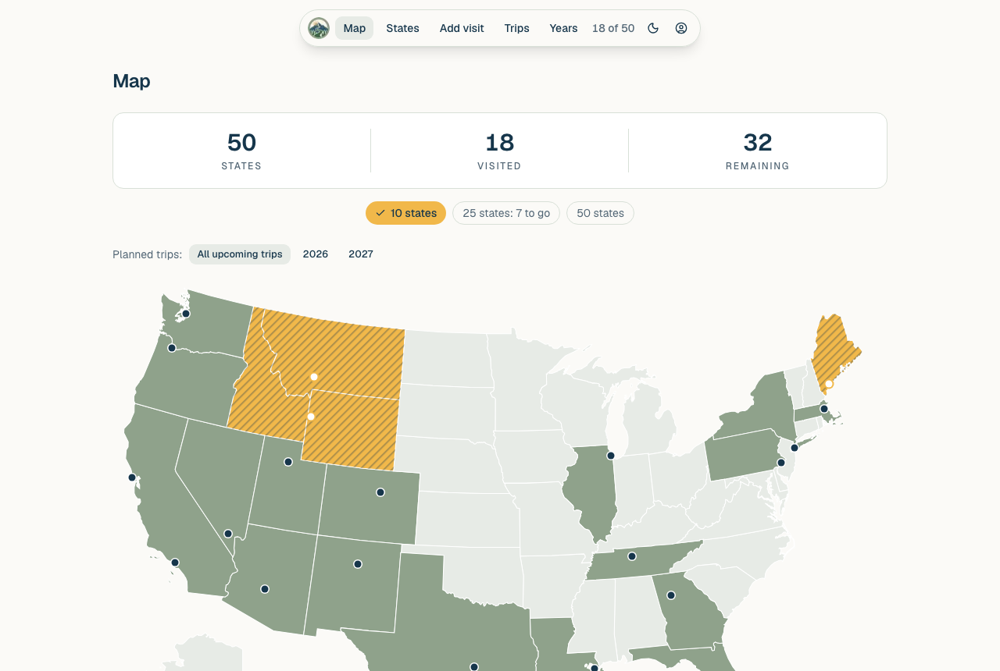
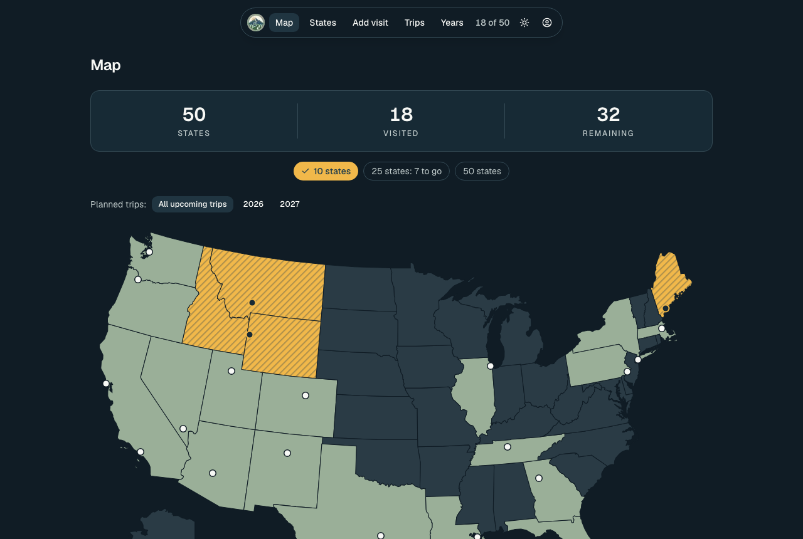
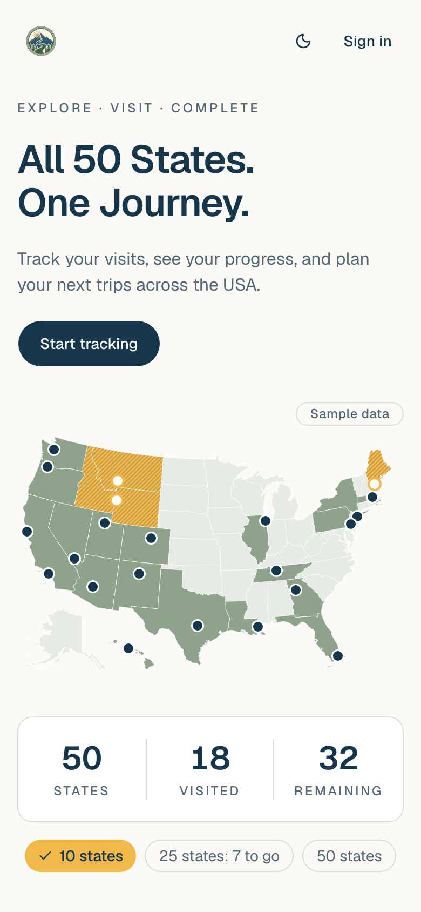
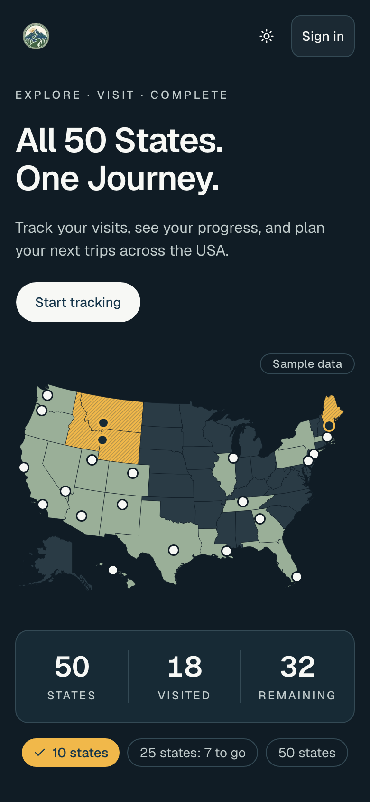
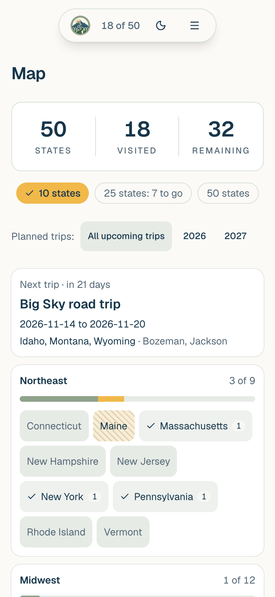
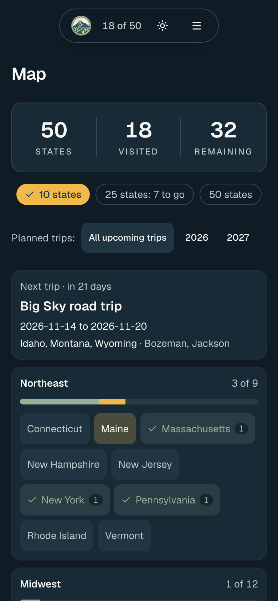

# 50 States Tracker

A personal tracker for visiting all 50 US states. Mark the states you've
visited (with a date, a city, a note, a story and photos), plan upcoming trips,
and watch the map fill in: sage for visited, striped gold for planned. Each
person signs in and sees only their own tracker. It's a Next.js rewrite of an
earlier Flask app, and it runs on Vercel with a Turso database.

**Live:** https://50-state-tracker-next.vercel.app

## Features

- **A landing page with sample data**, so visitors can see the app before signing up.
- **The map**: visited, planned and not-yet-visited states, city dots for visited and upcoming cities, and a year filter for trips. On phones it becomes the next trip and four region cards.
- **Progress**: 50 states, visited, remaining, with milestones at 10, 25 and 50 states and a one-time celebration when a visit reaches one.
- **Visits**: state, date, city (from the US Census city list), note, a longer story, and up to 6 photos, shrunk in the browser so their location data is removed.
- **Trips**: a name, dates, one or more states and cities. They can be edited, deleted or moved to another year, and the years page shows what each year adds.
- **Sharing**: a read-only link showing only which states you've visited. It's off until you turn it on.
- **Accounts** through Clerk, with whichever sign-in methods the Clerk app allows. Everyone sees only their own data, and deleting an account deletes its data.
- **Backup**: download your visits and trips as one SQLite file.
- **Light and dark themes** (with a soft fade between them), a brand palette whose text colors all pass 4.5 : 1 contrast, and a layout for desktop, iPad and iPhone, which can also open it from the home screen.

## Screenshots

The pictures use the app's sample data, not anyone's real trips. `pnpm screenshots` takes them again.

| | Light | Dark |
|---|---|---|
| Landing page, computer |  |  |
| Map, computer |  |  |
| Landing page, iPhone |  |  |
| Map, iPhone |  |  |

## How it was built

Built with [Claude Code](https://claude.com/claude-code), working from the
rules in [CLAUDE.md](CLAUDE.md), in small steps called slices:

1. **Plan first.** Each change starts as a written plan, and no code is written until it's approved.
2. **Tests first.** The slice's tests are written and reviewed before the code that makes them pass.
3. **All checks, every time:** lint, typecheck, a production build, the unit tests (Vitest, each with its own temporary database) and the browser tests (Playwright, at computer and iPhone size, signed in as two Clerk test people).
4. **Screenshots** of every change at desktop, iPad and iPhone width, in light and dark.
5. **A pull request per slice**, with a Vercel preview. GitHub runs the same checks again, split over three machines, before anything is merged. After each deploy, `pnpm test:live` checks the live site.

Code reviews (`/code-review`) after a slice turn their findings into follow-up
slices, tests first as well. Today that's about 490 unit tests and 230 browser
tests. Ideas for later are in [docs/roadmap.md](docs/roadmap.md).

**Stack:** Next.js (App Router), React, TypeScript, Tailwind CSS, shadcn/ui
(Base UI), Clerk, Drizzle ORM with Turso (libSQL), Vercel Blob, motion,
Vitest and Playwright.

## Running it yourself

Setup, settings, checks, backups, the photo store and the Clerk settings are in
[docs/operations.md](docs/operations.md).
